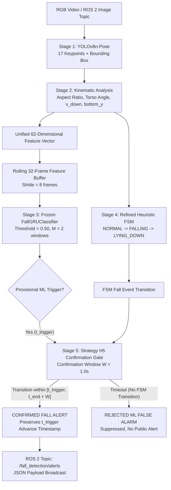

# Real-Time Hybrid Fall Detection System

[](https://www.python.org/)
[](https://pytorch.org/)
[](https://github.com/ultralytics/ultralytics)
[](https://docs.ros.org/)

An edge-ready, real-time fall detection system integrating deep learning temporal modeling with biomechanical heuristic verification using **Strategy H5 (ML Early Trigger + Heuristic Confirmation)**.

By coupling a 2-layer Recurrent Neural Network ([`FallGRUClassifier`](scripts/model.py)) with a Refined Finite State Machine ([`RefinedFallDetector`](scripts/fall_detector_refined.py)), the system achieves robust fall detection with early advance warning while eliminating false alarms.

---

## Key Highlights

- **Advance Warning Lead Time**: Alerts are timestamped to the initial dynamic collapse (**mean advance lead time: +1.154s** before ground impact).
- **Zero False Alarms**: 100% suppression of isolated machine learning false alarms (17/17 false alarms rejected across 36 production recordings).
- **Duplicate Suppression**: 0 duplicate alerts during post-fall motionless floor recovery.
- **Edge Performance**: Custom feature extraction, recurrent GRU inference, and Strategy H5 confirmation gate run in **8.6 ms/frame** on CPU, achieving >100 FPS on GPU/NPU edge accelerators.

---

## Architecture Overview



---

## Repository Structure

```
Fall_Detection_Project/
├── config/
│   ├── detector_config.yaml              # Baseline detector configuration
│   └── hybrid_detector_config.yaml       # Strategy H5 production configuration
├── data/
│   ├── features/                         # Pre-extracted 62-d kinematic features (.npz)
│   ├── pseudo_labels/                    # Baseline pseudo-labels
│   ├── pseudo_labels_refined/            # Refined pseudo-labels
│   ├── splits/                           # Train/validation/test splits
│   └── training_dataset/                 # Packaged training datasets (.npz)
├── models/
│   ├── best_fall_gru.pt                  # Frozen production FallGRU model weights
│   └── phase15/                          # Model checkpoint & training logs
├── results/
│   ├── full_hybrid_evaluation/           # Evaluation reports & metrics (Markdown/JSON)
│   ├── refined_detection/                # Detection summary reports
│   └── step17_acceptance/                # Production acceptance verification reports
├── scripts/
│   ├── fall_detector.py                  # Baseline heuristic fall detector
│   ├── fall_detector_refined.py          # Refined 3-state FSM fall detector
│   ├── hybrid_detector.py                # Strategy H5 hybrid detection engine
│   ├── model.py                          # FallGRUClassifier PyTorch model definition
│   ├── run_hybrid_pipeline.py            # Unified CLI runner (ROS 2 / video / bag / replay)
│   ├── ros2_hybrid_node.py               # Native ROS 2 image subscriber & alert publisher
│   └── verify_deployment.py              # Pre-flight deployment verification suite
├── yolov8n-pose.pt                       # YOLOv8 nano pose estimation model weights
├── requirements.txt                      # Project Python dependencies
├── DEPLOYMENT.md                         # Detailed Production Deployment Manual
└── README.md                             # Project overview & quick start
```

---

## Installation & Quickstart

### 1. Clone the Repository
```bash
git clone https://github.com/Harini-N-S/fall-detection.git
cd fall-detection
```

### 2. Install Dependencies
```bash
pip install -r requirements.txt
```

### 3. Verify Deployment Health
Run the automated pre-flight sanity test:
```bash
python scripts/verify_deployment.py
```
Expected output:
```
======================================================================
RESULT: ALL 6 CHECKS PASSED -- SYSTEM IS READY FOR DEPLOYMENT.
======================================================================
```

---

## Execution Modes

The unified pipeline runner [`scripts/run_hybrid_pipeline.py`](scripts/run_hybrid_pipeline.py) provides flexible execution modes:

### Mode A: Live ROS 2 Node
Subscribes to camera image topic and publishes alerts to `/fall_detection/alerts`:
```bash
python scripts/run_hybrid_pipeline.py --live-ros2
```

### Mode B: Direct Rosbag Replay (.db3)
Replays SQLite3/Zstandard `.db3` bag files:
```bash
python scripts/run_hybrid_pipeline.py --replay-bag path/to/bag.db3 --output-json results/alert.json
```

### Mode C: High-Speed Feature Stream Replay (~1,200 FPS)
Evaluates detection logic on pre-extracted feature sets:
```bash
# Single recording replay
python scripts/run_hybrid_pipeline.py --replay-features 20260817_153818

# All 36 benchmark recordings
python scripts/run_hybrid_pipeline.py --replay-features all --output-json results/regression_log.json
```

### Mode D: Video File / Live Webcam Stream with Visual Overlay
```bash
# Video file
python scripts/run_hybrid_pipeline.py --video path/to/video.mp4 --visualize

# Live USB Webcam (Device 0)
python scripts/run_hybrid_pipeline.py --camera 0 --visualize
```

---

## Alert Message Schema

When a fall is confirmed, an alert payload is broadcasted over ROS 2 topic `/fall_detection/alerts`:

```json
{
  "event_id": "FALL_20260817_153818_001",
  "session_id": "20260817_153818",
  "status": "CONFIRMED_FALL",
  "final_alert_time": 1.067,
  "ml_trigger_time": 1.067,
  "ml_end_time": 2.100,
  "heuristic_confirmation_time": 2.867,
  "advance_lead_time_seconds": 1.800,
  "confirmation_delay_seconds": 1.800,
  "event_duration_seconds": 1.800,
  "peak_ml_probability": 0.9842,
  "mean_ml_probability": 0.9125,
  "fsm_state": "LYING_DOWN"
}
```

For complete benchmarking results, operational profiles, and hardware tuning, see [DEPLOYMENT.md](DEPLOYMENT.md).
